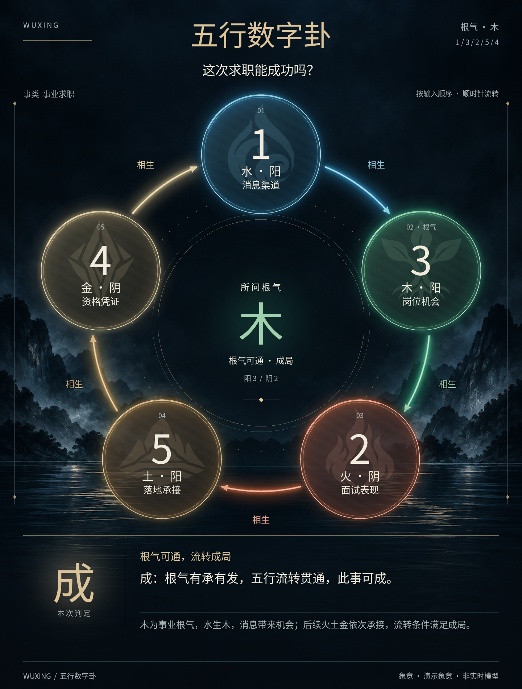
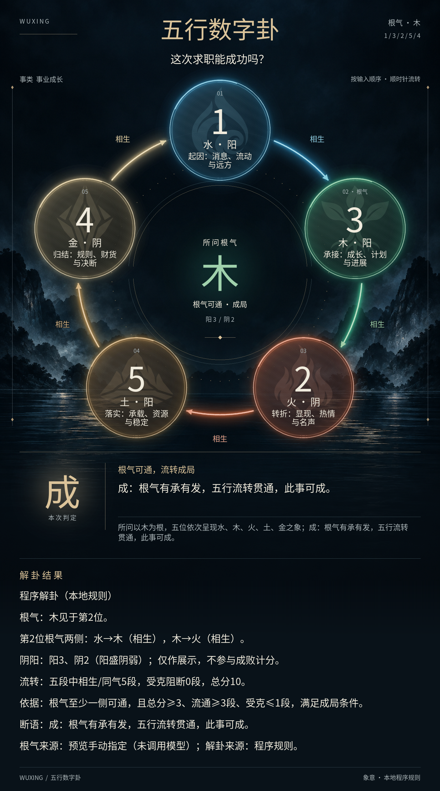

# wuxing_num（五行数字卦图）

## v2.2.0 群与个人 Token 排行

调用排行增加各群、每个人的累计 Token，可切换按调用次数或 Token 消耗降序排列。按全部正式卦例汇总后分页，后台测试不参与；个人合并同平台各群与私聊用量。未知和旧版未记录用量单独标注，部分已知显示累计下限，不按 0 补齐。详见 [排行口径](docs/management.md)。

## v2.1.0 每卦 Token 记录

新增每卦输入、输出、缓存命中和总 Token 记录，历史列表、详情、后台测试结果及 JSON 导出均可查看。读取模型接口实际返回的 usage，不按字数估算；纯本地起卦为 0，缺失用量与旧卦例标为未知或未记录。缓存命中包含在输入中，不重复计入总量。后台解读失败但已返回用量时仍保存。

正式指令记录 AI 取根气用量，后台记录可选 AI 解读用量。Agent 工具内部不请求模型，外部 Agent 对话无法准确归属单卦，因此明确显示“未知 · 外部 Agent”，不把整段对话消耗误记为本卦。原有每日额度、起卦规则与调用排行口径保持不变。详情见 [管理页面说明](docs/management.md)。

## v2.0.0 内核与管理页面

新增资料推演内核 `document_v2`，实现补齐五行、全阳转阴、逐轮生克和事项合卦，保留每一步过程；经典环形计分内核 `legacy_v1` 完整保留。升级默认仍使用经典内核，重载后在插件详情的“数字卦管理 → 内核与设置”切换并保存，正式指令和 Agent 同步生效。

管理页包含内核设置、起卦实验室、群/个人调用排行、历史卦例四部分。实验室可以勾选“含 AI 解析”，不勾选则全程本地；生成真实卦图预览，测试单独记录，不混入正式排行、不消耗群成员额度。历史详情可以重看图片和当时的程序 / AI 解读，一键导出全部卦例 ZIP（`cases.json` 与 `说明.md`）。

资料内核不是旧内核改分值：它没有环形分数或死卦停问；无法由资料及明确约定推演的组合输出“待定”。资料本身未写全，部分简例不能完整复现，应期只保留可核对的案例补数，不自动指定日期。完整规则、案例对照及待补充部分见 [资料内核说明](docs/kernel-v2.md)，配置与计数口径见 [管理页面说明](docs/management.md)。以下原有流转计分与三次死卦说明仅适用于经典内核。

AstrBot 专用的五行数字卦插件。它把五个数字按河图数字五行映射为：

- 1、6 为水
- 2、7 为火
- 3、8 为木
- 4、9 为金
- 5、0 为土

数字阴阳按奇偶划分：`1、3、5、7、9` 为阳，`0、2、4、6、8` 为阴。排盘会逐位显示阴阳，并统计阴阳数量和纯阴、纯阳或阴阳偏盛状态。

插件只注册 `/数字卦` 和专用 Agent 工具 `divine_wuxing_five_numbers`，没有全局消息监听，不会接管六爻、铜钱、摇卦、爻辞或纳甲请求。每次有效起卦生成一张 PNG 卦图；基础尺寸为 `1440 × 1900`，包含解卦正文时向下扩展。

## 卦图设计

- 正式标题为「五行数字卦」，采用深墨底、金色标题、环形气路与中央根气的东方幻想风布局。
- 使用独立无字山水底图呈现山体、薄雾与湖面倒影；背景素材和最终生成提示词见 [底图说明](assets/backgrounds/README.md)。底图缺失时回退到本地绘制背景。
- 圆弧采用抗锯齿亮芯、近光和宽幅柔光三层叠加，节点使用带细微材质的玻璃底和双层发光边缘。光晕先模糊遮罩再着色，避免颜色与透明度同时模糊导致压暗。
- 参考用户提供的元素标志风格，重新生成五行专属徽记：水纹、火焰、枝叶根系、金属刃面、层叠山岩。
- 五个宫位顺时针排列，箭头和标签显示相生、同气、耗气、逆生或受克。
- 元素徽记去掉白底，以约 13% 不透明度作为属性背后的大幅水印；数字、五行与象意位于水印上层，保持不透明。
- 五个数字以圆形节点呈现，根气节点标注「根气」，中央汇总根气、阴阳数量及规则状态；底部独立显示本次判定。
- 关系沿圆弧顺时针连接，采用实线/虚线和完整关系文字双重编码；受克弧另加阻断刻线。仅真实流通的边使用柔光，不添加不存在的关系。
- 死卦中央使用断续装饰环和明确原因，不把「根气不现」画成「根气受克」；成败死卦均使用计算内核的原结论。
- 长问题、逐位象意和总象按区域自动换行及缩小字号，过长文字显示省略号；断语拥有固定独立区域。
- 图片写入问题、根气、事类、逐位象意、总象、流转关系和固定断语。

流程为：接收问题与五个数字 → AI 只根据问题选择根气 → 程序判卦并解读 → 返回一张完整图片。数字、阴阳、流转、成败、五位象意、总象和解卦正文全部由本地程序生成。AI 不解卦，也不根据数字或预期吉凶调整根气。

| 数字 | 五行 | 专属徽记 |
| --- | --- | --- |
| 1、6 | 水 | 青蓝水滴与卷浪 |
| 2、7 | 火 | 朱红烈焰与镂空焰心 |
| 3、8 | 木 | 翠绿枝叶与根系 |
| 4、9 | 金 | 金色菱形金属刃面 |
| 5、0 | 土 | 赭黄山峰与层叠岩土 |

借鉴参考图的纯色、尖端曲线与镂空设计语言，徽记专为水火木金土重新生成。金直接表现为金属，不用雷代替。相生相克仍按原五行算法计算，不采用游戏元素反应；LLM 提示与工具说明包含这条边界。

徽记图集保存在 `assets/icons/wuxing_emblems.png`，随插件发布；不依赖临时附件路径或外网。缺少或损坏时使用无水印的五行节点，数字、属性和判定仍正常显示。来源、图集布局和生成提示词见 [素材说明](assets/icons/README.md)。Pillow 将随包背景与程序绘制的节点、光效、流转关系和文本确定性合成，不需要每次调用图片生成模型。

使用 `python tools/preview.py`（在插件目录执行）重新生成下方示例；其中象意为演示数据。

使用 `python -B tools/preview.py --all` 生成成、败、根气不现、根气被截和长文本五种预览；也可用 `--case failure --output-dir <目录>` 单独输出。预览只调用真实计算内核和渲染器，不调用 LLM、不发送群消息、不修改死卦次数。此次视觉调整不修改判卦规则或三次死卦处理逻辑。



使用 `python -B tools/preview.py --with-analysis` 生成下方单图结果预览。预览根气手动指定，象意、判卦、解卦正文和图片均通过实际本地程序生成；不调用在线模型。



## 用法

```text
/数字卦 13254 这次求职能否成功
/数字卦 这次求职能否成功 | 1 3 2 5 4
/数字卦 合同能否顺利签下 | 13254 | 金
```

支持“数字 + 问题”的新格式，并兼容原来的竖线格式。仅发送 `/数字卦 12345` 时会提示补充具体问题，不起卦、不计次；不会从群聊中猜测问题。省略根气时，AI 只根据所问事项选择唯一根气；旧格式第三段指定根气时，跳过 AI、纯本地运行。

`command_ai_analysis_enabled` 保留旧配置键，现仅控制 AI 取根气，默认开启。程序先校验问题、数字和三次死卦停问规则；校验通过后，只把问题交给模型，要求返回水、火、木、金、土中的一个字。拿到有效根气后才计算成败、更新死卦状态并生成图片，群聊使用真实 @ 组件回复问卦人，私聊直接发图。模型请求使用空历史、不挂载工具，不读取群聊、人格或历史对话，也不写入聊天历史；不会向取根气模型提供数字、流转或判卦结论。

原图底部的「解卦结果」由程序填入：根气位置与相邻生克、阴阳统计、流通段数、受克段数、得分及成败依据，末尾保留原内核固定断语。阴阳仅展示，不加入原有成败计算。图中标明根气来源和程序解卦来源；死卦次数及第三次停问提示也写入同一张图。原山水背景、节点和配色保持不变，正文按长度扩展画布。图片生成、发送失败或超过单图容量（总高度 10000 像素）时，返回完整文字卦例和程序解卦。

AI 关闭、额度用尽、没有模型、响应不是唯一根气字、请求失败或超时时，不使用猜测根气继续判卦，不更新死卦次数；会提示手动指定根气重试。手动指定根气的有效命令始终可本地运行，不消耗 AI 次数。

Agent 调用 `divine_wuxing_five_numbers` 时只需提供：

- `question`：用户实际所问之事。
- `five_numbers`：恰好五个数字。
- `root_element`：根据问题本质选出的唯一根气。

原有事类、五位象意和总象参数已移除，这些文字均由程序生成。工具内不会再请求模型，发送同一张程序解卦图后，主 Agent 应直接结束回复，不追加 AI 解读；更新后重载插件以刷新工具定义。

用户没有提供数字时，Agent 可以自行给出五个数字，但必须在答复中公开这五个数字。

经典内核每次给出下列三种结果之一（资料内核另有“待定”）：

- `成`：根气可流通，流转分不低于 3，至少三段同气/相生，且至多一段受克阻断。
- `败`：卦可立，但流转条件不足，明确判为不成。
- `死卦`：根气不现，或根气两侧均不通；要求为同一问题重新给五个数字。

同一用户对同一问题连续三次得到死卦后，插件会明确告知“此事天机不可泄露”，并提示停止对该事项继续使用五行数字卦；该提示不限制六爻。记录保存在 `data/plugin_data/wuxing_num/dead_streaks.json`。

## 流转计分

五行按五个位置首尾成环计算：同气 `+1`、顺生 `+2`、逆生泄气 `-1`、我克耗气 `0`、受克阻断 `-2`。最终输出包含数字、阴阳序列、五行链、根气、每段关系、逐位象意、总象、判定和一句确定断语。

## 测试

```powershell
python -m pytest astrbot_plugin_wuxing_num/tests -q
```

## AI 取根气与每日额度（v1.7.0）

默认每位用户在每个群每天可以使用 **1 次五行数字卦 AI 取根气**，同一真实消息计 1 次。北京时间每天零点恢复；各群分别计数，六爻与数字卦分别计数。沿用原额度记录，不因升级清零。程序解卦不调用模型，不增加 AI 次数。

| 配置 | 默认值 | 说明 |
| --- | --- | --- |
| `ai_daily_limit` | `1` | 所有群的默认每日次数；`0` 为不限 |
| `ai_daily_group_limits` | `[]` | 指定群号或 UMO 的 `limit` 覆盖默认值；首条有效匹配规则生效 |
| `command_ai_analysis_enabled` | `true` | 指令是否使用 AI 取根气；沿用旧配置键。手动指定根气时不调用 AI |
| `llm_tool_enabled` | `true` | 允许聊天 Agent 使用插件能力；关闭后隐藏工具并在入口拒绝调用，与指令 AI 开关独立 |
| `command_provider_id` | 空 | 取根气模型提供商 ID；留空跟随当前会话模型 |
| `command_analysis_timeout_seconds` | `60` | 模型请求超时，范围 5–180 秒 |
| `command_root_prompt` | 空 | 可补充事项归类规则；始终只提供问题并要求返回一个根气字 |

旧版 `command_interpretation_prompt`、`command_reply_max_chars` 和 `command_reply_trim` 已停用，不会将旧解卦提示词用于取根气。原模型选择和超时配置键继续生效。

开启 `llm_tool_enabled` 后，调用工具属于 Agent 取根气使用，仍检查 AI 额度。额度用尽时拒绝新的 AI 取根气和起卦，不更新死卦次数。用户可亲自指定根气使用本地命令；AI 不应代用户执行纯指令绕过限额。

非法输入、无事不卜、连续三次死卦后被拒绝的请求不计次。没有可用模型时不计 AI 次数；真正发起取根气请求后即计次，超时、无效响应、模型失败或后续图片发送失败不会退回。Agent 工具在有效卦记录保存后计次，后续图片失败仍返回文字材料。

限额数值有效范围为 `0–10000`。该限制覆盖本插件工具入口和实际模型调用；主 Agent 完全不调用本插件、仅凭已有聊天上下文生成的文字不在计数范围内。


## 问卦规则（v1.4.1）

无事不卜：命令和 Agent 工具都要求说明真实、具体的事情；空问题、只写方向、随便看看、消遣或测试不予起卦，也不累计死卦次数。Agent 必须结合上下文确认确有其事，不得编造事由；本地规则拦截常见无事表述，不能代替完整语义理解。

五行数字的纯本地排盘不设次数限制，也不套用六爻的同事连续起卦限制；AI 取根气受上述每日额度约束，保留原有同一问题连续三次死卦处理规则。


## 术数独立（v1.4.2）

五行数字卦的状态、结论和三次死卦停问提示仅作用于五行数字。先测五行数字后，对同一事项仍可请求六爻；反过来也一样，六爻的重复事项与额度不适用于五行数字。两者不共享记录，不互相计次、不互相重置，也不能互用原卦。

命令与工具返回值明确标注适用范围，Agent 按用户当前选择的术数调用工具。当前明确请求五行数字时，问题中提到历史六爻结果不会因关键词被拒绝；当前明确请求六爻时应使用六爻工具。更新后重载本插件以刷新工具说明。

原有每群分别计数、指定群覆盖规则和三次死卦规则保持不变；本次没有加入六爻专属反馈奖励或卦例库。
