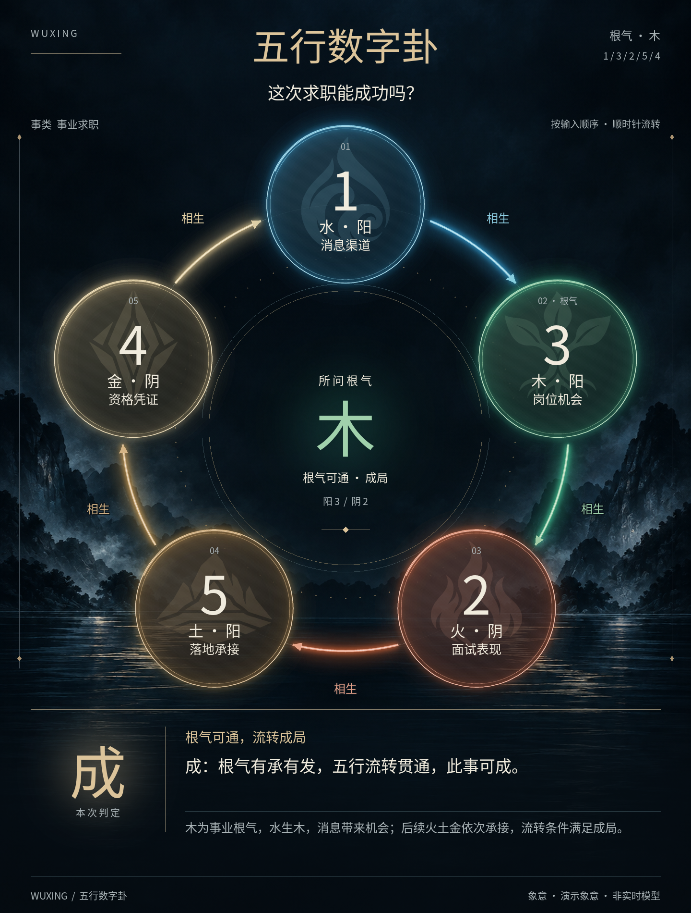

# wuxing_num（五行数字卦图）

AstrBot 专用的五行数字卦插件。它把五个数字按河图数字五行映射为：

- 1、6 为水
- 2、7 为火
- 3、8 为木
- 4、9 为金
- 5、0 为土

数字阴阳按奇偶划分：`1、3、5、7、9` 为阳，`0、2、4、6、8` 为阴。排盘会逐位显示阴阳，并统计阴阳数量和纯阴、纯阳或阴阳偏盛状态。

插件只注册 `/数字卦` 和专用 Agent 工具 `divine_wuxing_five_numbers`，没有全局消息监听，不会接管六爻、铜钱、摇卦、爻辞或纳甲请求。每次有效起卦都会生成一张 `1440 × 1900` PNG 卦图。

## 卦图设计

- 正式标题为「五行数字卦」，采用深墨底、金色标题、环形气路与中央根气的东方幻想风布局。
- 使用独立无字山水底图呈现山体、薄雾与湖面倒影；背景素材和最终生成提示词见 [底图说明](assets/backgrounds/README.md)。底图缺失时回退到本地绘制背景。
- 圆弧采用抗锯齿亮芯、近光和宽幅柔光三层叠加，节点使用带细微材质的玻璃底和双层发光边缘。光晕先模糊遮罩再着色，避免颜色与透明度同时模糊导致压暗。
- 参考用户提供的元素标志风格，重新生成五行专属徽记：水纹、火焰、枝叶根系、金属刃面、层叠山岩。
- 五个宫位顺时针排列，箭头和标签显示相生、同气、耗气、逆生或受克。
- 元素徽记去掉白底，以约 13% 不透明度作为属性背后的大幅水印；数字、五行与象意位于水印上层，保持不透明。
- 五个数字以圆形节点呈现，根气节点标注「根气」，中央汇总根气、阴阳数量及规则状态；底部独立显示本次判定。
- 关系沿圆弧顺时针连接，采用实线/虚线和完整关系文字双重编码；受克弧另加阻断刻线。仅真实流通的边使用柔光，不添加不存在的关系。
- 死卦中央使用断续装饰环和明确原因，不把「根气不现」画成「根气受克」；成败死卦均使用计算内核的原结论。
- 长问题、逐位象意和总象按区域自动换行及缩小字号，过长文字显示省略号；断语拥有固定独立区域。
- 图片写入问题、根气、事类、逐位象意、总象、流转关系和固定断语。

其中数字、阴阳、五行关系和成败由本地计算内核确定；Agent 工具的事类、五位象意及总象由调用 Agent 分析。普通命令先用本地规则象意发图，再通过独立模型请求返回完整文字解卦；关闭 AI、额度用尽及模型不可用时仍保留本地排盘。LLM 不得修改插件算出的结论。

| 数字 | 五行 | 专属徽记 |
| --- | --- | --- |
| 1、6 | 水 | 青蓝水滴与卷浪 |
| 2、7 | 火 | 朱红烈焰与镂空焰心 |
| 3、8 | 木 | 翠绿枝叶与根系 |
| 4、9 | 金 | 金色菱形金属刃面 |
| 5、0 | 土 | 赭黄山峰与层叠岩土 |

借鉴参考图的纯色、尖端曲线与镂空设计语言，徽记专为水火木金土重新生成。金直接表现为金属，不用雷代替。相生相克仍按原五行算法计算，不采用游戏元素反应；LLM 提示与工具说明包含这条边界。

徽记图集保存在 `assets/icons/wuxing_emblems.png`，随插件发布；不依赖临时附件路径或外网。缺少或损坏时使用无水印的五行节点，数字、属性和判定仍正常显示。来源、图集布局和生成提示词见 [素材说明](assets/icons/README.md)。Pillow 将随包背景与程序绘制的节点、光效、流转关系和文本确定性合成，不需要每次调用图片生成模型。

使用 `python tools/preview.py`（在插件目录执行）重新生成下方示例；其中象意为演示数据。

使用 `python -B tools/preview.py --all` 生成成、败、根气不现、根气被截和长文本五种预览；也可用 `--case failure --output-dir <目录>` 单独输出。预览只调用真实计算内核和渲染器，不调用 LLM、不发送群消息、不修改死卦次数。此次视觉调整不修改判卦规则或三次死卦处理逻辑。



## 用法

```text
/数字卦 13254 这次求职能否成功
/数字卦 这次求职能否成功 | 1 3 2 5 4
/数字卦 合同能否顺利签下 | 13254 | 金
```

支持“数字 + 问题”的新格式，并兼容原来的竖线格式。仅发送 `/数字卦 12345` 时会提示补充具体问题，不起卦、不计次；不会从群聊中猜测问题。旧格式的第三段根气可省略，省略时继续按现有本地规则归类。

`command_ai_analysis_enabled` 默认开启：先完成本地起卦、保存死卦状态并发送卦图，再将本次问题与完整文字卦例交给模型，独立请求一次解卦；结果返回后使用真实 @ 消息组件回复问卦人（私聊直接回复）。请求显式使用空历史、不挂载工具，只提供插件的独立系统提示，不读取群聊上下文、会话人格或历史对话，也不写入聊天历史。模型调用遵循 [AstrBot 官方 LLM 接口](https://docs.astrbot.app/dev/star/guides/ai.html)。

命令卦图中的象意来源为本地规则；AI 的完整解释通过后续文字返回，末尾保留计算内核的固定断语。AI 开关关闭、额度用尽、请求失败或超时均保留本地排盘；图片失败时仍返回文字卦例。

Agent 调用工具时必须先根据问题明确选择一个根气元素，并提供：

- `matter_type`：明确的事物类型，例如事业求职、财务交易、感情婚姻。
- `five_symbolic_meanings`：严格按五个数字原顺序写五条象意，以 `｜` 分隔。
- `symbolic_summary`：结合问题、根气和流转写出的明确总象，不得修改成败结论。

用户没有提供数字时，Agent 可以自行给出五个数字，但必须在答复中公开这五个数字。

每次只会给出三种明确结果之一：

- `成`：根气可流通，流转分不低于 3，至少三段同气/相生，且至多一段受克阻断。
- `败`：卦可立，但流转条件不足，明确判为不成。
- `死卦`：根气不现，或根气两侧均不通；要求为同一问题重新给五个数字。

同一用户对同一问题连续三次得到死卦后，插件会明确告知“此事天机不可泄露”，并提示停止对该事项继续使用五行数字卦；该提示不限制六爻。记录保存在 `data/plugin_data/wuxing_num/dead_streaks.json`。

## 流转计分

五行按五个位置首尾成环计算：同气 `+1`、顺生 `+2`、逆生泄气 `-1`、我克耗气 `0`、受克阻断 `-2`。最终输出包含数字、阴阳序列、五行链、根气、每段关系、逐位象意、总象、判定和一句确定断语。

## 测试

```powershell
python -m pytest astrbot_plugin_wuxing_num/tests -q
```

## AI 开关与每日额度（v1.6.0）

默认每位用户在每个群每天可以使用 **1 次五行数字卦 AI 起卦与解读**，同一真实用户消息中的起卦和解读合计 1 次。北京时间每天零点恢复；各群分别计数，六爻与数字卦分别计数。额度记录持久化于本插件 KV，重载插件不会清零。

| 配置 | 默认值 | 说明 |
| --- | --- | --- |
| `ai_daily_limit` | `1` | 所有群的默认每日次数；`0` 为不限 |
| `ai_daily_group_limits` | `[]` | 指定群号或 UMO 的 `limit` 覆盖默认值；首条有效匹配规则生效 |
| `command_ai_analysis_enabled` | `true` | 指令是否独立请求一次 AI 解卦；关闭后纯本地排盘不消耗 AI 次数 |
| `llm_tool_enabled` | `true` | 允许聊天 Agent 使用插件能力；关闭后隐藏工具并在入口拒绝调用，与指令 AI 开关独立 |
| `command_provider_id` | 空 | 独立解卦使用的模型提供商 ID；留空跟随当前会话模型 |
| `command_analysis_timeout_seconds` | `60` | 模型请求超时，范围 5–180 秒 |
| `command_reply_max_chars` | `280` | 解卦正文上限，范围 0–2000；0 不限，极小值仍保留完整固定断语 |
| `command_reply_trim` | `true` | 超长时按句截断，保留固定断语 |
| `command_interpretation_prompt` | 空 | 自定义独立解卦提示词，空值使用内置文本 |

开启 `llm_tool_enabled` 后，调用 `divine_wuxing_five_numbers` 始终属于 AI 使用，包括由调用 Agent 提供全部象意的情形。达到额度时，工具拒绝新的 AI 起卦和解读，不生成新卦、不更新死卦次数。普通命令达到 AI 额度后仍提供本地排盘，并提示已达限额；AI 不应代用户执行纯指令绕过限额。

非法输入、无事不卜、连续三次死卦后被拒绝的请求不计次。普通指令没有可用模型时只作本地回退，不计 AI 次数；真正发起模型请求后即计次，超时、模型失败或图片发送失败不会退回。Agent 在有效卦记录保存后计次，后续图片失败仍返回文字材料。

限额数值有效范围为 `0–10000`。该限制覆盖本插件工具入口和实际模型调用；主 Agent 完全不调用本插件、仅凭已有聊天上下文生成的文字不在计数范围内。


## 问卦规则（v1.4.1）

无事不卜：命令和 Agent 工具都要求说明真实、具体的事情；空问题、只写方向、随便看看、消遣或测试不予起卦，也不累计死卦次数。Agent 必须结合上下文确认确有其事，不得编造事由；本地规则拦截常见无事表述，不能代替完整语义理解。

五行数字的纯本地排盘不设次数限制，也不套用六爻的同事连续起卦限制；AI 起卦与解读受上述每日额度约束，保留原有同一问题连续三次死卦处理规则。


## 术数独立（v1.4.2）

五行数字卦的状态、结论和三次死卦停问提示仅作用于五行数字。先测五行数字后，对同一事项仍可请求六爻；反过来也一样，六爻的重复事项与额度不适用于五行数字。两者不共享记录，不互相计次、不互相重置，也不能互用原卦。

命令与工具返回值明确标注适用范围，Agent 按用户当前选择的术数调用工具。当前明确请求五行数字时，问题中提到历史六爻结果不会因关键词被拒绝；当前明确请求六爻时应使用六爻工具。更新后重载两个插件以刷新工具说明。

提示词可用 `{question}`、`{chart}`、`{max_chars}`，自定义后仍会附加真实问题和卦例。原有每群分别计数、指定群覆盖规则和三次死卦规则保持不变；本次没有加入六爻专属反馈奖励或卦例库。
